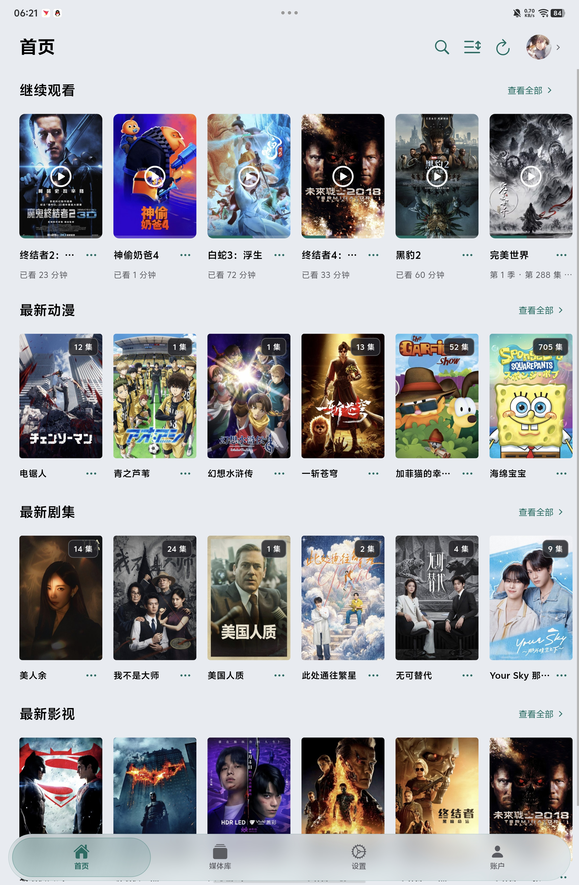
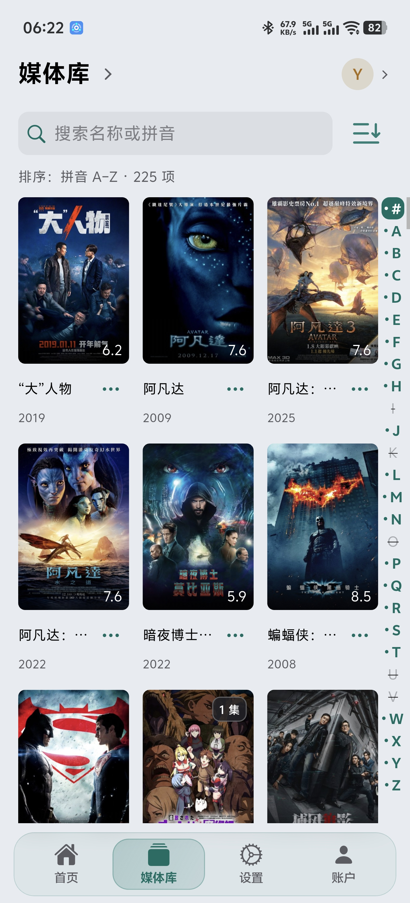

<div align="center">
  
  <h1>Yingyu · 映屿</h1>
  <p><strong>为个人 Emby 媒体库打造的 Android 第三方客户端</strong></p>
  <p>原文件播放 · 手机/平板适配 · 多账号 · 观看进度 · 原盘与 STRM 通用兼容</p>
  <p>
    <a href="https://github.com/kai489646859-netizen/Yingyu/releases/tag/android-v0.9.2"></a>
    <a href="https://github.com/kai489646859-netizen/Yingyu/releases"></a>
    
  </p>
  <p>
    <a href="#下载与安装">下载</a> ·
    <a href="#快速开始">使用方法</a> ·
    <a href="#功能一览">功能</a> ·
    <a href="#界面预览">界面</a> ·
    <a href="#问题反馈">反馈</a>
  </p>
</div>

> [!IMPORTANT]
> 映屿不提供任何影视、音频、字幕、服务器或账号。请仅连接你有权使用的 Emby 服务，并仅播放你拥有或已获授权的内容。

## 关于映屿

映屿是一款面向个人 Emby 媒体库的 Android 客户端。它把媒体库浏览、个性化整理、观看记录和应用内 MPV 播放整合在同一个界面中，支持手机与平板，并坚持以原文件播放为默认方向，不主动要求服务器转码。

当前公开版本为 **0.9.2 / code 107**。Windows 版本不在本次发布范围内。

## 功能一览

| 类别 | 能力 |
| --- | --- |
| 媒体库 | 首页分区、完整媒体库、搜索、拼音侧栏、排序筛选、电影/剧集详情、季与选集、多版本选择 |
| 账户 | 多个 Emby 服务器与账号保存、快速切换、账号排序、头像同步、连接状态提示 |
| 个人状态 | 继续观看、收藏、已看/未看、喜欢/不喜欢同步；本机“想看”列表；异常时保留待同步进度 |
| 播放 | 内置 MPV、原文件播放、续播/从头播放、准确定位、倍速、画面比例、章节、音轨、字幕与字幕延迟 |
| 手势 | 单击控制栏、双击暂停、横向滑动定位、左右竖滑亮度/音量、长按临时 2×/3×、播放锁定 |
| 连播 | 上一集/下一集、自动下一集、自定义片头片尾、手动或自动跳过、返回观看 |
| 兼容 | 普通媒体、STRM、302/反向代理来源；ISO/BDMV 原盘读取与播放列表选择；HDR/杜比信息识别和兼容映射 |
| 外观 | 深浅主题、5 款主题色、海报墙/图文列表、手机竖屏与平板横竖屏布局、可减少动画 |
| 缓存 | 独立海报/详情图缓存、图片加载节奏、可选视频缓存、应用私有图形着色器缓存 |
| 辅助 | 英译中离线翻译、脱敏诊断日志、筛选/复制/导出日志、缓存清理与开源许可查看 |

### 0.9.2 重点更新

- 修复部分原盘加载完成后仍停在暂停状态、必须再次点击播放的问题；用户主动暂停、定位、换片和退出仍优先。
- 原盘切换音轨时重新取得解码起点，并等待本次定位与输出刷新完成，避免继续使用切轨前的不完整缓存。
- 新音轨无法正常输出时仍会有界回退原选择并给出真实提示，不会把失败选择保存为偏好。
- 保留原画、不转码、倍速、字幕、观看进度和手机/平板交互。

> 0.9.2 的静态分析、离线合成测试、编译、签名与包结构核对已经完成，但不能替代真实设备和真实媒体测试。首次自动开播、音轨实际输出、持续倍速、间歇字幕、原盘连续播放与色彩仍受设备、网络、服务器和片源影响。

## 界面预览

下列均为实际设备界面截图；媒体海报仅用于展示用户自有媒体库的界面效果。

### 首页与自适应布局

| 平板横屏首页 | 平板竖屏首页 |
| --- | --- |
|  |  |

| 手机媒体库 | 平板横屏媒体库 |
| --- | --- |
|  |  |

### 竖屏浏览与账户

| 竖屏媒体库 | 竖屏账户 | 竖屏设置 |
| --- | --- | --- |
|  |  |  |

### 横屏账户、设置与日志

| 横屏账户 | 横屏设置 |
| --- | --- |
|  |  |


### 设置选项

| 设置 1 | 设置 2 |
| --- | --- |
|  |  |

| 设置 3 | 设置 4 |
| --- | --- |
|  |  |

## 下载与安装

前往 [Android 0.9.2 发布页](https://github.com/kai489646859-netizen/Yingyu/releases/tag/android-v0.9.2) 下载：

- `Yingyu-0.9.2.apk`：Android 安装包。
- `SHA256SUMS.txt`：下载文件校验值。
- `Yingyu-0.9.2-source.zip`：与安装包对应的完整源码归档。
- `Yingyu-0.9.2-symbols.zip`：调试符号，普通用户无需下载。
- `Yingyu-0.9.2-更新与验证说明.txt`：本版变化、验证结果和已知边界。

安装要求与注意事项：

1. Android 8.0（API 26）或更高版本。
2. 从旧版升级时，直接安装 APK 覆盖即可；**不要先卸载**，否则本机账号、缓存和设置可能丢失。
3. 0.9.2 / code 107 与此前正式交付版本使用同一应用身份和签名。
4. 建议先核对 `SHA256SUMS.txt`。Windows PowerShell 可运行：

   ```powershell
   Get-FileHash .\Yingyu-0.9.2.apk -Algorithm SHA256
   ```

5. 本版本作为预发布版本提供。重要设备建议保留上一版安装包，并先用常看片源试播。

## 快速开始

1. 打开映屿，选择“添加服务器”。
2. 填写 Emby 地址、用户名和密码。地址可包含协议、端口与反向代理路径。
3. 登录后在首页或媒体库浏览内容；也可使用搜索、排序和筛选。
4. 打开详情页，选择媒体版本、季/集或直接播放。映屿默认请求原文件播放，不主动要求服务端转码。
5. 播放时可切换音轨、字幕、章节、倍速和画面比例；常用手势见上方“功能一览”。
6. 遇到问题时，在“设置 → 日志记录”中导出日志，再按下方格式反馈。

### STRM、302 与反向代理

映屿按通用 HTTP/Emby 协议处理 STRM、重定向和反向代理，不要求特定网盘或代理程序。能否原画播放仍取决于服务器返回的地址、请求头、权限、Range 支持、网络链路和源站状态。

### ISO / BDMV 原盘

映屿可以读取 ISO/BDMV 的播放列表并选择主片或其他列表。短于 3 分钟的非当前、非主片列表默认收起，但“显示全部”仍可查看短片、分集和剪辑。原盘菜单、BD-J 和所有蓝光交互能力并不等同于基础播放列表读取。

### HDR 与杜比说明

- 映屿基于 MPV、FFmpeg、libplacebo 等组件进行播放与兼容处理，最终效果依赖片源、设备解码能力、Android 图形栈和显示设备。
- 当前实现包含杜比视界信息识别及 SDR 兼容映射等处理，但不代表杜比官方认证，也不承诺所有 Profile、双层 FEL、直通或所有设备上的显示效果。
- “能够打开”或“能够出画”不等于音画、色彩、定位、字幕、音轨和连续播放均已完整兼容。
- 出现偏色、黑屏、卡顿或音画不同步时，请先保留日志并提交问题，不建议仅凭资源名称判断格式。

## 问题反馈

欢迎在 [Issues](https://github.com/kai489646859-netizen/Yingyu/issues) 反馈。为了更快定位，请尽量提供：

- 映屿版本与 versionCode。
- 设备型号、Android 版本、芯片/GPU，以及是否连接电视或功放。
- Emby Server 版本；是否经过 HTTPS、反向代理、STRM 或 302。
- 问题类型：普通文件、STRM、ISO/BDMV；视频/音频/字幕格式及杜比 Profile（如果日志能确认）。
- 从点击播放到问题出现的操作步骤、时间点和是否能够稳定复现。
- 通过应用导出的诊断日志；提交前请再次检查并遮盖服务器地址、账号、令牌、文件名等隐私信息。

请勿公开上传账号密码、API Key、Access Token、完整媒体直链、私人域名、用户媒体日志或未脱敏截图。

## 更新记录

- [Android 完整更新历史](CHANGELOG-Android.md)
- [版本归档与发布规则](RELEASE_POLICY.md)
- [全部 Releases](https://github.com/kai489646859-netizen/Yingyu/releases)

## 免责声明、商标与许可

- 本项目是独立的第三方客户端，与 Emby LLC、Dolby Laboratories、MPV 项目及截图中媒体作品的权利人不存在隶属、授权或背书关系。Emby、Dolby 等名称和商标归各自权利人所有。
- 本软件按现状提供，不保证适用于所有服务器、设备、网络或媒体格式。安装、升级、播放和配置变更的风险由使用者自行承担。
- 本项目不绕过访问控制、不提供媒体资源，也不鼓励侵权。用户应遵守所在地法律、服务器规则及相关服务条款。
- 源码包中的第三方组件分别遵循其各自许可证与通知。当前工程根 `LICENSE` 与本仓库早期页面曾显示的 GPL-3.0 标注不一致，因此本页面不再用单一徽章概括全部代码；具体授权请以源码包内对应文件为准，后续会继续整理许可证边界。

---

<div align="center">
  <p>如果映屿对你有帮助，欢迎支持后续维护：</p>
  
</div>
