

  
  <h1>Yingyu · 映屿</h1>
  
  

    
    
  

  
  
<strong>Yingyu（映屿）</strong>是一款基于 Emby 和 MPV 的跨平台影视客户端。支持登录 Emby 服务器，提供原文件播放、媒体库浏览、多账号管理与跨设备进度同步。

  
  
📢 <strong>当前状态</strong>：本项目为跨平台版本归档仓库。已归档 Android 版本，Windows 版本正在规划中。

---

## 📸 界面展示

### 📱 移动端体验 (平板/手机)

  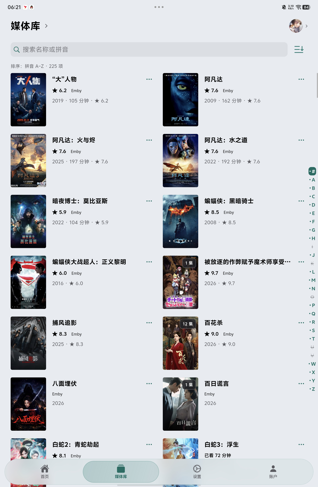
  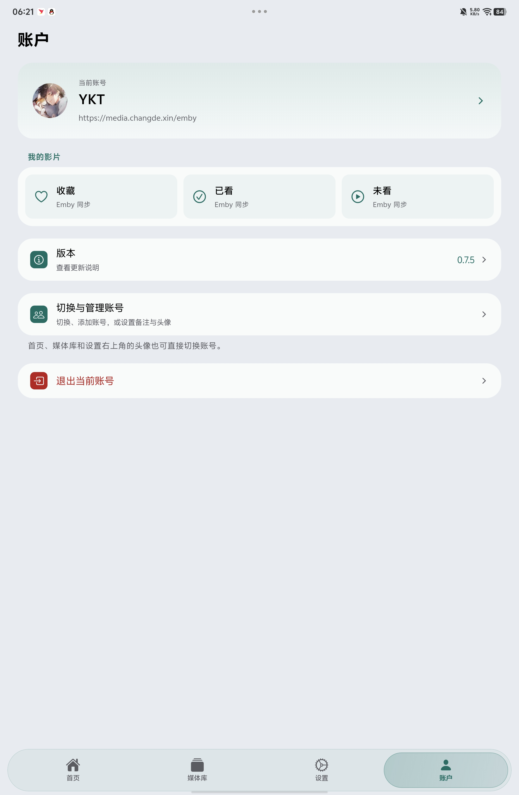
  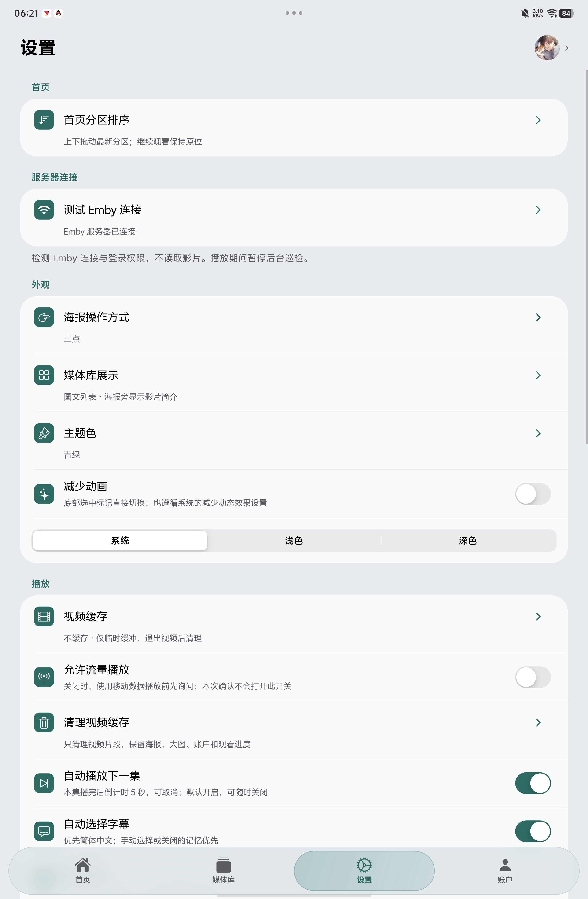
  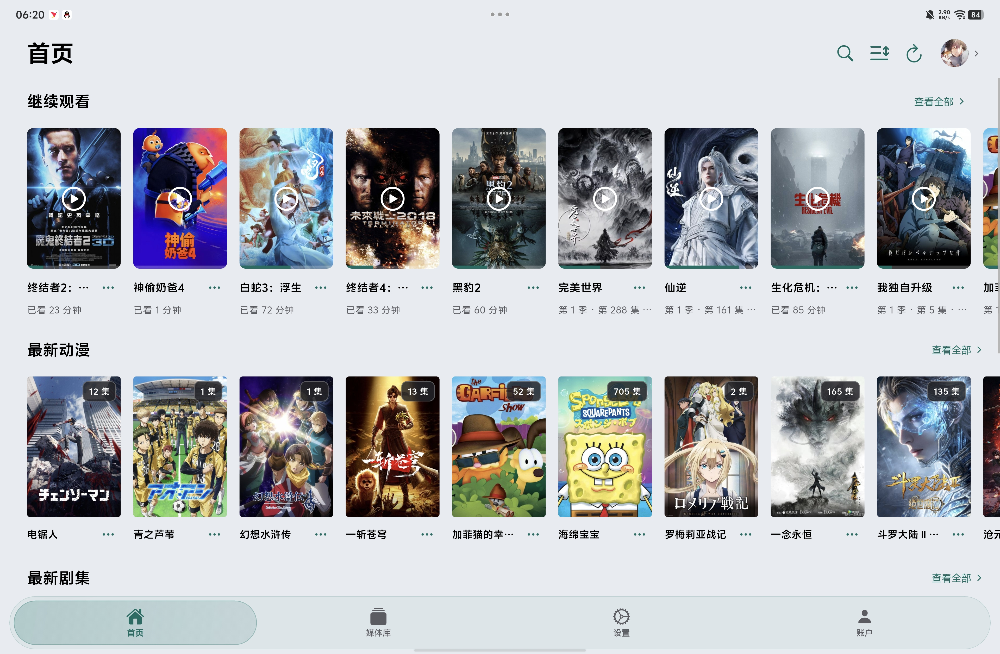
  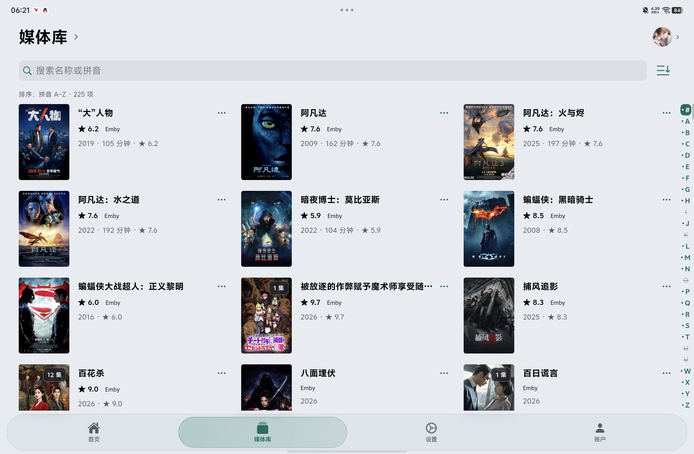
  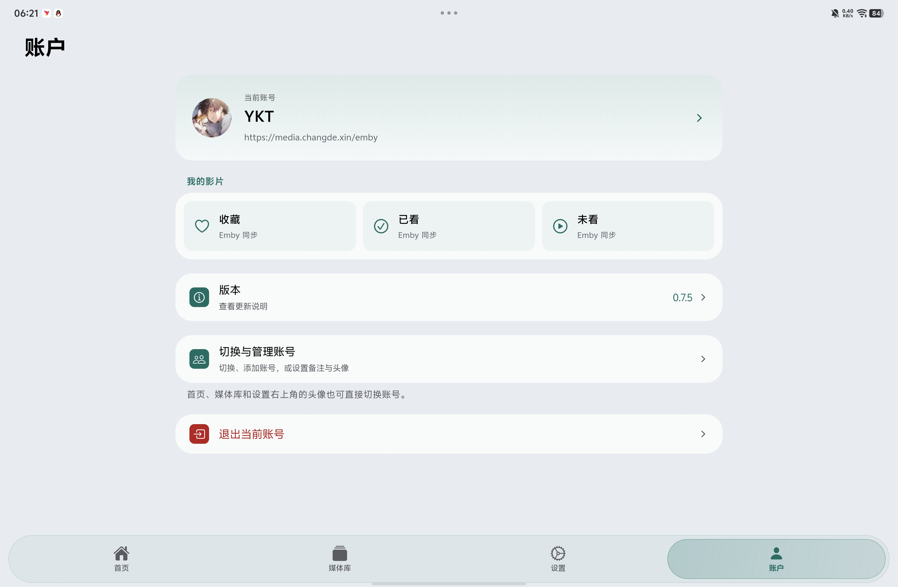
  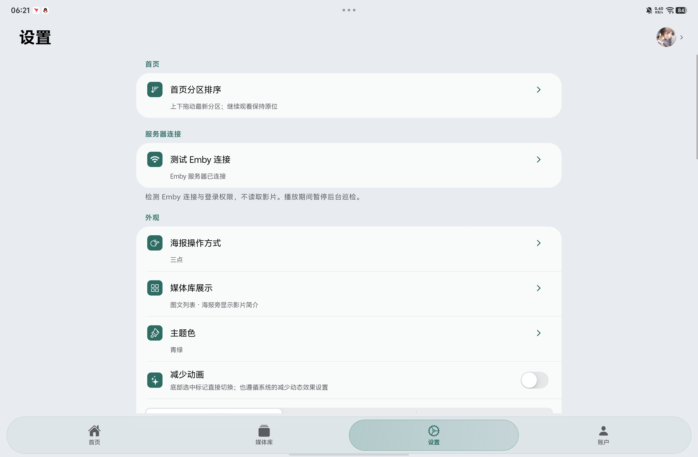
  
<em>移动端体验</em>

---

## 📖 部分功能展示

### 1. 部分功能设置

  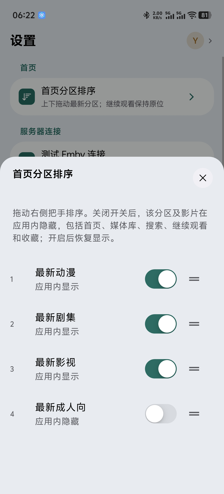
  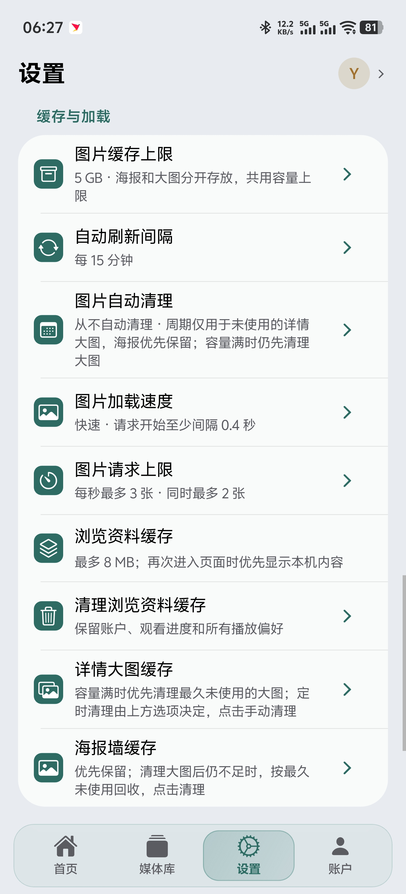
  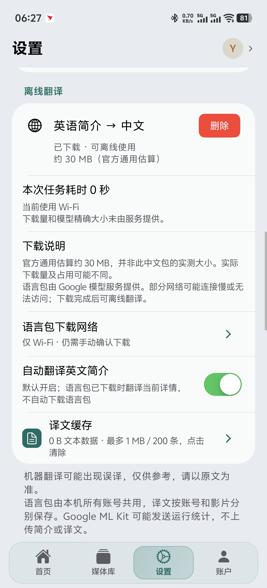
  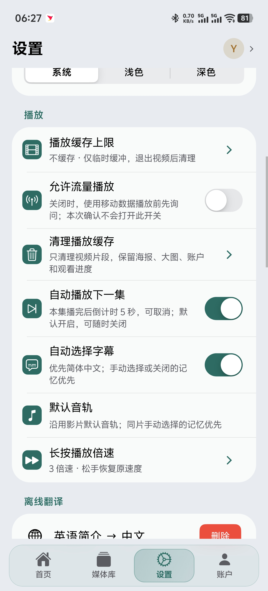

### 2. 原码播放与强大解码
底层深度集成 MPV 播放器核心，支持直接播放原文件，支持多种字幕格式与音轨切换。

### 3. 媒体库浏览与海报墙
直观展示 Emby 服务器的媒体资源，支持分类浏览、搜索，手机与平板自适应。

### 4. 日志可视化与隐私保护
提供直观的日志可视化功能，方便排查播放问题。不上传签名私钥、账户凭据或用户媒体日志，所有数据仅保存在本地与你的 Emby 服务器中。

  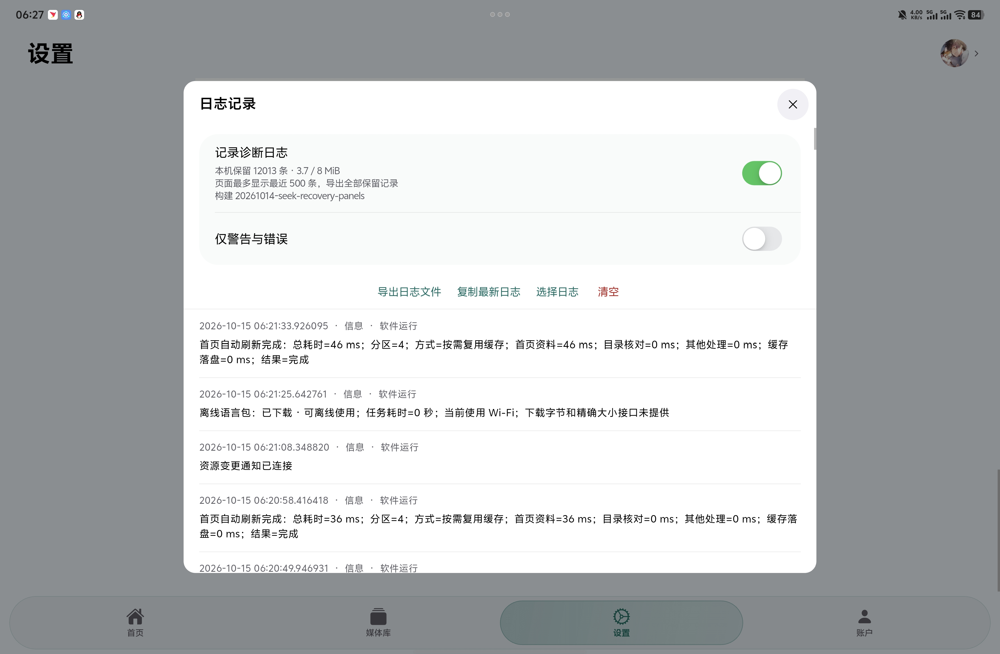
  
<em>日志可视化展示</em>

---

## 📥 下载与安装

| 平台 | 已归档版本 | 安装包 (Assets) |
| :--- | :--- | :--- |
| **Android** | [0.7.1 (最新)](https://github.com/kai489646859-netizen/Yingyu/releases/tag/android-v0.7.1) | `Yingyu-0.7.1.apk` |
| Android 历史版本 | [0.6.9](https://github.com/kai489646859-netizen/Yingyu/releases/tag/android-v0.6.9) | `Yingyu-0.6.9.apk` |
| Windows | 后续安排 | *当前仓库尚未发布* |

**⚠️ 安装必读：**
1. **签名与升级**：Android 同签名升级可直接覆盖，保留账户、观看进度与设置。
2. **版本降级**：旧版仅作历史归档，不建议较低版本直接覆盖安装到高版本上。
3. **校验文件**：每个版本同时附带对应的 `Yingyu-版本号-source.zip` 和 `SHA256SUMS.txt`。

---

## 🚀 软件的使用方法

### 第一步：添加 Emby 服务器
1. 打开 Yingyu 客户端，点击“添加服务器”。
2. 输入你的 Emby 服务器地址、账号和密码，完成登录。

### 第二步：浏览与播放
1. 登录成功后，首页展示媒体库（参考上方界面展示）。
2. 点击任意电影，点击“播放”，调用内置 MPV 播放器。

### 第三步：设置与日志排查
1. 点击侧边栏的“设置”，管理账号或添加新服务器。
2. 若遇到播放问题，可在设置中查看“可视化日志”，并且能够导出获取报错信息后再向开发者反馈。

---

## 📖 部分app功能介绍
1.emby同账户同步\
&ensp;同账户下能够实时：同步emby“继续观看记录”、收藏、已看、未看\
2.首页分区排序\
&ensp;除“继续观看记录”外能够拖放调节emby影视资源文件夹顺序（非修改emby文件夹顺序）及是否可见该文件夹及内容（非修改emby文件夹可见性）\
3.账户管理\
&ensp;支持登录多个emby服务器及账户（如上所属同账户之间同步）\
4.个性化外观\
&ensp;支持三点、长按的操作方式（具体设置可见）、支持修改主题色（5款色彩可选）、媒体库展示（以传统海报墙展示或图文列表展示）、减少过渡动画\
5.播放设置\
&ensp;视频缓存（可选）、允许流量播放、清理缓存、自动播放下一集、自动选择字幕、默认音轨选择、长按倍速选择（2/3倍）\
6.离线翻译\
&ensp;目前仅可翻译英文\
7.缓存与加载\
&ensp;加载速度可调节、图片自动清理可选、图片并行请求上限可选、海报墙/详情页大图缓存分开存放\
8.日志功能\
&ensp;支持日志可视化、app所有数据均在本地保存、允许导出日志文件、清空日志\
9.app测试\
&ensp;目前在IQOOPad6pro/IQOO15两台设备进行测试，能够播放iso原盘文件、支持302、支持strm、可能支持Dolby Vision P8（本人非专业人士，能够播放，是否生效未知）\

---

### 🎬 关于杜比 (Dolby) 支持的说明

由于本app基于 MPV 内核，杜比音视频的最终播放效果**高度依赖你的设备硬件解码能力**。具体情况如下：

- **杜比视界 (Dolby Vision)**：
  - 支持 Profile 8 降级为 HDR10 播放（颜色正常）。
  - 对于 Profile 5（流媒体专属），若无设备硬解支持，可能出现偏色，建议在 Emby 服务器端关闭杜比视界转码为 HDR10。
  - Profile 7（蓝光双层）通常仅能解码基础层。
- **杜比全景声 (Dolby Atmos)**：
  - 支持基于 E-AC-3 (Dolby Digital Plus) 的全景声解码与直通。
  - 对于基于 TrueHD 的无损全景声，需要你的设备支持 HDMI 直通给功放，否则可能降级为普通音轨播放。
- **建议**：若遇到杜比播放异常，请在 Emby 服务器端将视频转码为 H.264/H.265 (SDR)，音频转码为 AAC/AC-3，以获得最稳定的播放体验。

*(注：本软件为第三方开源客户端，不包含杜比官方商业授权，杜比相关解码完全依赖 Android 系统底层与设备硬件。)*
*(所有内容均为Ai生成请仔细甄别)*

---

## 📝 更新记录与发布规则

- [Android 完整逐版记录 (CHANGELOG-Android.md)](CHANGELOG-Android.md)
- [版本归档和发布规则 (RELEASE_POLICY.md)](RELEASE_POLICY.md)

## 🛠️ 技术细节与反馈

- **技术栈**：Android 客户端使用 Emby + MPV。
- **反馈渠道**：欢迎在 Issues 中提供设备型号、系统版本及日志截图（注意脱敏）。

## 📄 开源协议与致谢

本项目应用与对应源码按 **GPL-3.0** 交付。
第三方组件遵循各自许可证；本项目为第三方开源客户端，与 Emby 官方无直接关联。

---

  <em>如果映屿对你有帮助，欢迎扫码支持开发者继续更新，感谢各位的投喂：</em> 
  

